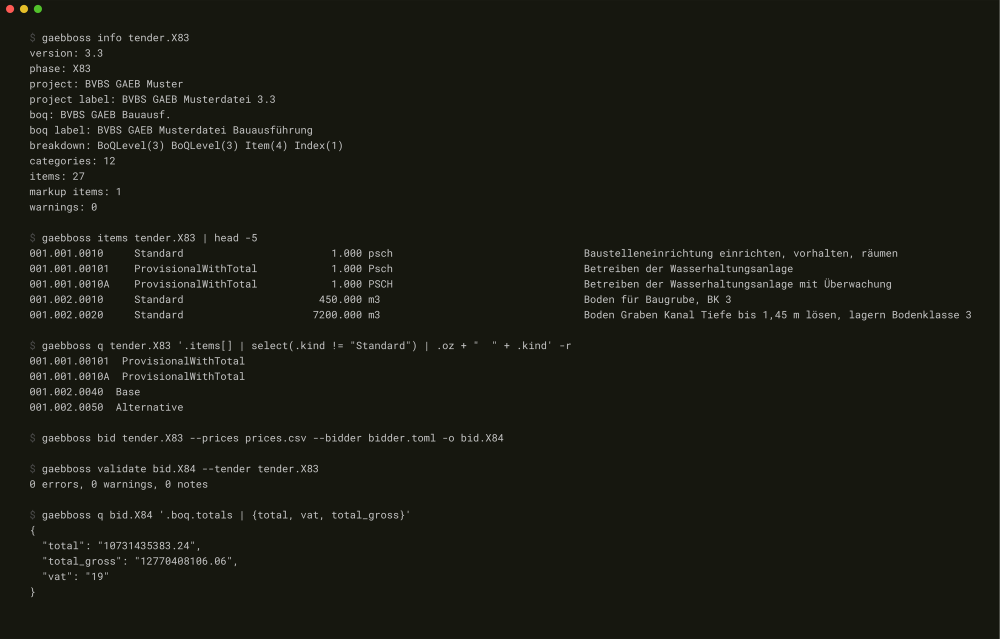
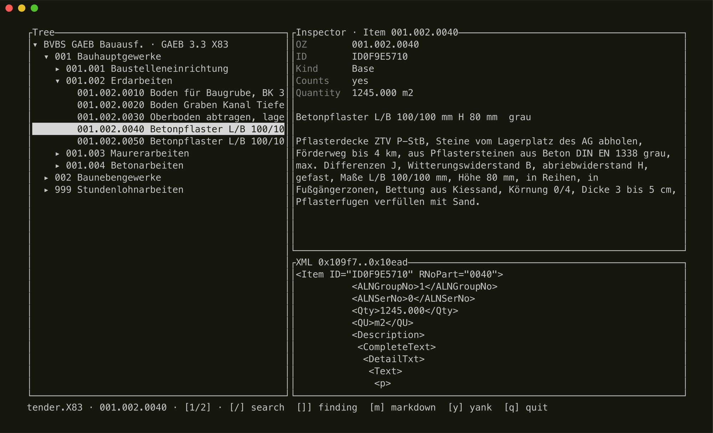
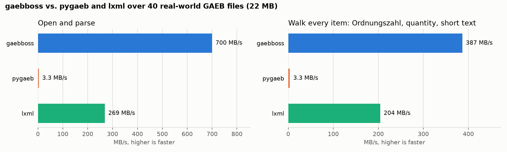

<p align="center">
  
</p>

<p align="center">
  <strong>GAEB DA XML in pure Rust: read German construction tenders, bids and orders, validate them, write schema-valid X83, X84 and X86, and turn a tender into a priced bid. One core, a CLI, and pythonic bindings.</strong>
</p>

<p align="center">
  <a href="https://github.com/4thel00z/gaebboss/actions/workflows/ci.yaml"></a>
  <a href="https://github.com/4thel00z/gaebboss/actions/workflows/python-ci.yml"></a>
  <a href="https://gaebboss.dev/docs/"></a>
  <a href="https://pypi.org/project/gaebboss/"></a>
  
  <a href="#license"></a>
</p>

<p align="center">
  <a href="https://gaebboss.dev">gaebboss.dev</a> ·
  <a href="https://gaebboss.dev/docs/">Docs</a> ·
  <a href="https://pypi.org/project/gaebboss/">PyPI</a> ·
  <a href="https://crates.io/crates/gaebboss-cli">crates.io</a> ·
  <a href="#benchmarks">Benchmarks</a>
</p>

---

GAEB is how German construction procurement moves: the Leistungsverzeichnis leaves the planner as an X83, comes back from every bidder as an X84, and becomes an order as an X86. Reading it should not take a DOM, a float, or a port of somebody else's guesses. gaebboss is built from the official gaeb.de schemas and the Fachdokumentation: the typed model, the readers, the writers and the per-phase rules are **generated from the XSDs**, money and quantities are fixed-point, and the engine is a **lenient reader** that tolerates what real AVA exports do wrong and reports it instead of refusing. One core behind the `gaebboss` CLI and the `gaebboss` Python package.

## Highlights

- **Generated from the standard**: 525 elements of DA XML 3.1, 3.2 and 3.3 typed, read and written straight from the vendored XSDs; `cargo xtask gen --check` fails CI when the code drifts from the schema ([coverage](docs/src/reference/coverage.md)).
- **Every phase, every version**: X80 to X89 in DA XML 3.0 to 3.3 read losslessly; X83, X84 and X86 written in 3.2 and 3.3, element order and phase restrictions from the phase XSD, proven valid against the official schemas with lxml ([conformance](scripts/conformance.sh)).
- **Fastest GAEB implementation measured**: 700 MB/s parsing real files from Python, about 210× pygaeb and 2.6× raw lxml; the 75 MB X81 in the corpus reads in 29 ms ([benchmarks](#benchmarks)).
- **No floats near money**: `Decimal { mantissa, scale }` throughout, kaufmännisch rounding and item, discount and category totals per Fachdokumentation 4.6.17.
- **Tender to bid**: `Bid::from_tender` takes an X83, applies unit prices, price components, not-offered marks, free quantities, bidder text complements, discount and VAT, and writes the X84 the way the "Regeln für X84" demand it, in the version the tender came in.
- **Bill-of-quantities semantics**: Ordnungszahlen formed from `BoQBkdn`, item kinds (Grund-, Alternativ-, Bedarfs-, Pauschal-, Zulage-, Stundenlohnposition), categories, markup items, declared against computed totals.
- **Texts as text**: long and short texts, bidder fields and placeholders projected to plain text or Markdown without a DOM.
- **Lenient, and it says so**: encodings repaired, mismatched tags closed, unknown vendor elements kept and re-emitted, every tolerated defect a `Warning` with a byte offset. Panics are denied by the workspace lints.

## Install

```bash
pip install gaebboss           # prebuilt abi3 wheels (CPython 3.12+), no toolchain required
cargo install gaebboss-cli     # the `gaebboss` binary
```

## Usage

```bash
gaebboss info      tender.X83                       # version, phase, project, bill, item and category counts
gaebboss items     tender.X83 --tsv                 # OZ, kind, quantity, unit, short text; --counting drops what the total ignores
gaebboss text      tender.X83 --oz 01.02.0010       # one long text; every item's without --oz
gaebboss md        tender.X83                       # the bill as Markdown: category headings, item long texts
gaebboss json      tender.X83 --compact             # the whole document, decimals as strings
gaebboss q         tender.X83 '.items[] | select(.kind == "LumpSum") | .oz' -r   # jq over the JSON
gaebboss hex       tender.X83 oz:01.02.0010         # hexdump the document or one element (oz:, id:, range:)
gaebboss tui       tender.X83                       # interactive explorer: tree, inspector, XML, findings
gaebboss validate  bid.X84 --tender tender.X83      # exit 1 on errors; structure and ids checked against the tender
gaebboss roundtrip tender.X83 -o copy.X83 --pretty  # parse and write back; --phase X84 --version 3.3 convert
gaebboss bid       tender.X83 --prices prices.csv --bidder bidder.toml -o bid.X84
gaebboss skill     install                          # the bundled Claude Code skill (-g for ~/.claude)
```

`-o` is short for `--out`. Exit codes: 1 when a file cannot be read or written, a jq program fails while running, or `validate` finds errors; 2 for an invalid jq program or a bad argument.

`prices.csv` is `OZ;unit price` (`;`, tab or `,`, a `-` price marks an item not offered, an optional third column is the quantity of a free-quantity item). `bidder.toml` carries `name1`, `street`, `pcode`, `city` and optionally `vat_percent` and `discount_percent`.

<p align="center">
  
</p>

<p align="center">
  
</p>

```python
from decimal import Decimal
import gaebboss

tender = gaebboss.Document("tender.X83")             # or Document(data=raw_bytes, name="tender.X83")
print(tender.version, tender.phase, tender.project.name, tender.boq.name)
for item in tender.items():                          # items(kind="counting") for what the total counts
    print(item.oz, item.kind, item.quantity, item.unit, item.short_text)
    print(item.long_text_markdown)
for warning in tender.warnings:                      # every tolerated defect, with its byte offset
    print(warning.code, warning.offset, warning.message)

bid = gaebboss.Bid.from_tender(tender, {"name1": "Bau GmbH", "street": "Weg 1", "pcode": "12345", "city": "Berlin"})
for item in tender.items():
    bid.price(item.id, Decimal("12.50"))
bid.not_offered(tender.items()[0].id)
bid.vat_percent(Decimal("19"))
x84 = bid.finish()                                   # a Document; raises on unpriced items
open("bid.X84", "wb").write(x84.write())
print(x84.validate_against(tender))                  # findings: severity, code, oz, message
```

```rust,no_run
use gaebboss_core::bid::{Bid, Bidder};
use gaebboss_core::decimal::Decimal;
use gaebboss_core::{Document, validate};

fn main() -> Result<(), Box<dyn std::error::Error>> {
    let tender = Document::open(std::path::Path::new("tender.X83"))?;
    for item in tender.items() {
        println!("{} {:?} {:?} {}", item.oz, item.kind(), item.quantity(), item.short_text());
    }
    let totals = tender.computed_totals();

    let bidder = Bidder { name1: "Bau GmbH".into(), ..Bidder::default() };
    let mut bid = Bid::from_tender(&tender, bidder)?;
    for item in tender.items() {
        bid.price(item.id(), Decimal::parse("12.50")?)?;
    }
    let x84 = bid.finish()?;
    std::fs::write("bid.X84", x84.write(&x84.x84_options())?)?;
    println!("{totals:?} {:?}", validate::validate_against_tender(&x84, &tender));
    Ok(())
}
```

<details>
<summary><strong>More: the layers underneath, writing options, JSON</strong></summary>

The typed model is one struct per schema type under `gaebboss_core::model`, generated from the 3.3 Lib and extended with what only 3.1 and 3.2 carry; strings are spans into the input, numbers are `Decimal`, and every struct keeps the children it does not know as raw nodes that are written back verbatim. Below it sit `bytes::normalize` (BOM, UTF-16, Latin-1, CP1252 and repair), `lexer::lex` (one `memchr` pass into a flat tape of spans) and `version::detect` (namespace, `GAEBInfo/Version`, `Award/DP` and the file extension).

```rust,no_run
use gaebboss_core::Document;
use gaebboss_core::write::WriteOptions;
use gaebboss_core::version::{Phase, Version};

fn main() -> Result<(), Box<dyn std::error::Error>> {
    let doc = Document::open(std::path::Path::new("tender.X83"))?;
    let (bytes, report) = doc.write_with_report(&WriteOptions {
        version: Version::V33,
        phase: Phase::X84,
        indent: Some(2),
        prog_system: None,
        strict: false,
    })?;
    println!("{} bytes, dropped {:?}, missing {:?}", bytes.len(), report.dropped, report.missing);
    println!("{}", gaebboss_core::json::to_json(&doc));
    Ok(())
}
```

`strict: true` turns a missing schema-required element into an error instead of a report line; real X83 files miss them often enough that reporting is the default. `Document::edit` hands out the typed tree for in-place changes; `write` applies the target phase's restrictions (what X84 drops from X83, what it makes mandatory) and the per-version element order.

</details>

## From tender to bid

What the "Regeln für X84" require, `Bid` does: the project, the bill and its structure are taken over unchanged from the tender, `CTR` becomes mandatory, `OWN`, `Requester`, construction site and owner texts are dropped, every `BoQCtgy` and the `BoQInfo` get totals, a not-offered item carries no unit price, a quantity is only written for free-quantity items, items that do not count toward the total (Bedarfspositionen ohne Gesamtbetrag, Alternativpositionen) carry no item total, and a price of 0.00 is transmitted as such. Item totals are `round2(Qty × UP)`, discounts apply to the rounded total and are rounded again, categories sum rounded item totals; the worked example of the Fachdokumentation (73.789 × 9.77 = 720.92, 710.11 after 1.5 %) is a unit test.

A 3.0 or 3.1 tender is answered in 3.2, the oldest version with phase schemas; 3.2 and 3.3 tenders are answered in their own version.

## Validation

`validate` reports what a receiving AVA system would reject or recompute: elements a phase does not allow or requires, duplicate or dangling ids, Ordnungszahlen that are not unique, not ascending or too long, decimals with more places than the schema gives them, item totals that do not match quantity times price, category and bill totals that do not match their items, unit prices on items not offered, quantities on non-free items in an X84. `validate --tender` adds the X84 against its X83: items missing or added, ids and structure that differ.

## Benchmarks

Against pygaeb (the fullest open GAEB reader, Python on lxml) and raw lxml over 40 real-world files (MB/s, higher is faster):

<p align="center">
  
</p>

**gaebboss is the fastest on both operations, including against lxml, which builds no GAEB model at all**: 700 MB/s opening and parsing against lxml's 269 and pygaeb's 3.3, and 387 MB/s walking every item with its Ordnungszahl, quantity and short text against lxml's 204 and pygaeb's 3.3.

<details>
<summary><strong>Method and fine print</strong></summary>

Best-of-3 per file over the first 40 files of a 164-file corpus of third-party exports (22 MB, DA XML 3.0 to 3.3), measured on an aarch64 workstation (Cortex-X925, 20 cores, single-threaded throughout) from the installed Python packages, every row in one session. The corpus is not redistributable; reproduce on your own files with [`benchmarks/bench.py`](benchmarks/README.md). The lxml rows parse the file and iterate `Item` elements reading `RNoPart`, `Qty` and `span` text: no Ordnungszahl formation, no kind, no decimals, so they are a floor for any lxml-based reader, not a competitor. pygaeb reads every text eagerly; its two rows coincide because parsing already does the work.

The Rust stages, from criterion on the same machine ([details](docs/src/reference/performance.md)):

| stage | dense synthetic 10 MB X83 | 75 MB real X81 |
|---|--:|--:|
| tokenize | 2.36 GiB/s | 15.2 GiB/s |
| typed parse | 675 MiB/s | 2.59 GiB/s |
| write back | 497 MiB/s | |

Over the whole corpus, `cargo xtask corpus` reads 189.6 MB at 866 MB/s with zero errors and writes it back at 421 MB/s.

</details>

## Proof

- Every official sample (gaeb.de Musterdateien 3.1, BVBS Prüfdateien 3.3) and all 164 corpus files read with zero errors; writing what was read gives a byte-identical file, and a second round trip is idempotent.
- `make conformance` writes X81 to X84 files from the official fixtures and validates them against the official XSDs with lxml: 8 of 8 valid.
- A failure-mode gallery (`tests/fixtures/failure-modes`) pins the lenient paths: wrong encodings, mismatched tags, duplicated totals, vendor elements, depth bombs.
- `cargo xtask gen --check` and `cargo xtask coverage --check` keep the generated code and the [schema coverage report](docs/src/reference/coverage.md) in step with the vendored schemas.

## Layout

| path | what |
|---|---|
| `crates/gaebboss-core` | the engine: bytes, tape, decimal, generated model, readers, writers, profiles, bill semantics, texts, validation, bid, JSON |
| `crates/gaebboss-cli` | the `gaebboss` binary |
| `crates/gaebboss-py`, `python/gaebboss` | the Python package (pyo3, maturin) |
| `crates/gaebboss-testkit` | fixture builder and corpus discovery |
| `xtask` | `cargo xtask gen` (schemas to code), `coverage`, `corpus` |
| `standard/` | the official XSDs, vendored unmodified with checksums |
| `tests/fixtures` | official sample files and the failure-mode gallery |
| `docs/` | the mdBook |

`make help` lists the targets; `make ci` runs what the Rust CI runs. Real-world files for the corpus tests and `make bench-py` are found through `GAEBBOSS_CORPUS`.

## Scope

Read: DA XML 3.0 to 3.3, phases X80 to X89. Written with phase rules: X83, X84, X86 in 3.2 and 3.3. Detected and named but not parsed: GAEB 90 (`.d8x`), GAEB 2000 (`.p8x`), DA XML 2.x with German element names, ÖNORM. The trade, cost and quantity phases (X31, X5x, X9x) and the Zeitvertrag phases are typed by the generated model but carry no business rules. See the [limitations](docs/src/reference/limitations.md).

## License

MIT or Apache-2.0, at your option. The schema files under `standard/` remain the work of GAEB / DIN; see `standard/README.md`.
